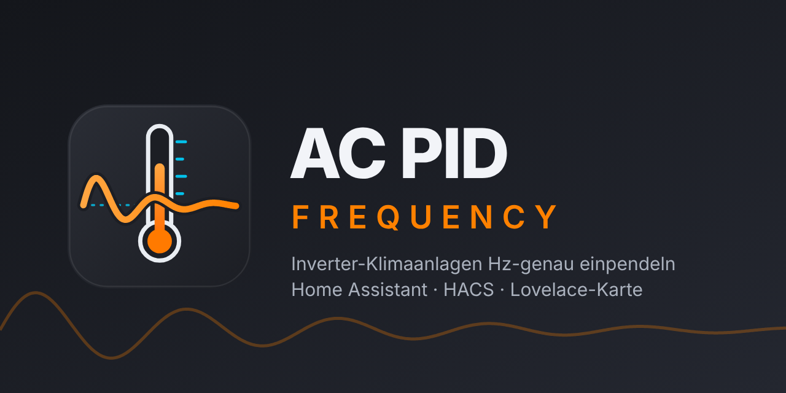

<p align="center">
  
</p>

# AC PID Frequency

🇩🇪 [Deutsche Version](README.md)

A Home Assistant integration (HACS) that gives an air conditioner a **simulated external room temperature sensor** and uses it to settle the compressor on a **target frequency (Hz)**. The actual control stays with the AC itself: the integration only shifts its input value in 0.1 K steps.

It works with any AC whose integration accepts an external room sensor (a Home Assistant entity) **and** exposes the compressor frequency as a number entity. On multi-split systems, only the master indoor unit (the one switched on first) is specified. **Heating mode** only for now.

## Highlights of the self-learning algorithm

* **Dynamic 5-pillar system for minimum modulation & shut-off protection:**
  If the target Hz is below the achievable minimum modulation (or the AC switches off), the controller catches the AC with a targeted cold offset and holds it stably at the minimum. Because the physical minimum modulation varies with weather and setpoint, the controller validates it dynamically using 5 pillars:
  1. **Weather zone separation:** Learned minimum Hz are stored separately per outdoor temperature zone (frost, transition, mild).
  2. **User trigger:** If the user changes the target Hz or the setpoint, the learned minimum is discarded: the AC may test and learn again.
  3. **Weather delta trigger (default: $\ge 5\,\text{K}$):** If the outdoor temperature changes noticeably, the minimum modulation is released for re-validation automatically (adjustable in the options).
  4. **Adjustable limit per zone:** The minimum Hz per outdoor zone (default frost 24 / transition 18 / mild 14 Hz) are adjustable in the options and serve as start value, reset value and lower limit. If your unit runs stably lower, enter the measured value there.
  5. **Soft probing (default: 240 min):** If the AC runs stably at minimum modulation for a long time, the controller carefully probes 1 Hz lower to unlock unused modulation potential (adjustable in the options).
* **Self-learning reaction time & gain:** Determines dead time and Hz change per 0.1 K dynamically from real step responses of the AC. Manual tuning of reaction times or gains is not needed.
* **Momentum detection (trend decoupling):** If the compressor is already moving towards the target, the controller waits patiently and avoids over-hasty corrections.
* **Complete defrost & post-defrost handling:** Detects defrost cycles (via `hvac_action` or a sensor), freezes the state and, after the defrost ends, waits through a 240-second hold phase before regulating again. The hold phase shows up as its own status `post_defrost`.
* **Weather-dependent 2D operating point learning:** Learns the required base offset separately per outdoor temperature zone (frost `< 2 °C`, transition `2–10 °C`, mild `> 10 °C`) and frequency range.
* **Thermal overheat protection:** Throttles the frequency gently if the actual room temperature exceeds the setpoint by more than, for example, 1.0 K.
* **No restart while the room is warm:** If the compressor is stopped and the real room is still at or above the setpoint (plus an adjustable margin), the controller does not push the AC to restart immediately. It sends setpoint +0.3 K instead (status `restart_wait`). The restart push only follows once the room has cooled down. The stop is not learned as minimum modulation. Only applies with a configured room sensor.
* **Pass through the real room temperature:** When the controller is off (or the AC is not heating), the generated sensor passes the real room temperature on 1:1, so the AC keeps using your room thermometer instead of its often too warm ceiling sensor.
* **Minimal configuration:** No emergency brake or dozens of confusing parameters: the algorithm takes care of the fine tuning. The options only contain deadband (default 2 Hz), minimum Hz per outdoor zone (24/18/14 Hz), restart margin, safety limits, the weather trigger ($\ge 5\,\text{K}$) and the soft probing interval (240 min).

## Installation

1. HACS → Custom repositories → add this repository as an *Integration* → install → **restart Home Assistant**.
   (Manually: copy the folder `custom_components/ac_pid_frequency` to `/config/custom_components/` and restart.)
2. Settings → Devices & services → Add integration → **AC PID Frequency**.
3. Select:
   * **Master climate entity** (required)
   * **Compressor frequency** (required)
   * **Outdoor temperature** (optional: sensor or weather entity)
   * **Real room temperature sensor** (optional: overheat protection, pass-through while regulation is off and the restart hold)
   * **Defrost sensor** (optional: binary sensor or sensor)
   * **Additional indoor units** (optional: display only)
4. In the AC's own integration, enter the generated sensor **"Simulated room temperature"** as the external room sensor.
5. Add the card (see below) and switch on **Hz control** (deliberately off after setup).

Everything can be changed later: integration → *Configure* → "Change entities" or "Change control parameters".

## Entities

| Entity | Purpose |
|---|---|
| `sensor` Simulated room temperature | Value for the AC (0.1 K). Controller off or AC not heating: **the real room temperature is passed through** (offset 0.0 K, changes immediately). Becomes **`unavailable`** if the room sensor is then missing or none is configured, or if data is missing for too long while regulating → the AC uses its own indoor sensor |
| `number` Target frequency | Desired compressor Hz. Input is limited downwards to the learned minimum modulation. Your own automations write here (e.g. PV logic) |
| `switch` Hz control | Controller on/off |
| `button` Reset minimum Hz | Resets only the learned minimum modulation of the outdoor zones to the configured base values (e.g. to re-test manually) |
| `button` Reset learned values | Resets all learning tables (operating point offsets, minimum modulation, reaction time) to factory settings |
| Diagnostic sensors | Status (incl. `defrost`, `post_defrost`, `restart_wait`, `overheat` and `min_mod`), offset, learned offset, frequency deviation, learned minimum modulation |

Example of your own automation (e.g. PV logic):

```yaml
action: number.set_value
target:
  entity_id: number.ac_pid_frequency_target_frequency
data:
  value: "{{ 48 if is_state('input_boolean.pv_surplus', 'on') else 22 }}"
```

## Passing through the real room temperature

| Situation | Sensor "Simulated room temperature" |
|---|---|
| Controller **on**, AC heating | Control value (setpoint − offset) |
| Controller **off** *or* AC not in heating mode, room sensor provides a value | Real room temperature, rounded to 0.1 K; follows every change **immediately** |
| Controller off / not heating, room sensor missing or not configured | `unavailable` → the AC uses its own sensor |
| Controller on, but setpoint/Hz missing > fault timeout | `unavailable` (status `fault`) |

The diagnostic attributes of the status sensor show with `passthrough: true` when the value is passed through; the card displays it as well.

## Lovelace card

Shipped with the integration and loaded automatically (no entry under *Resources* needed). In the dashboard, "Add card" → **AC PID Frequency**, or via YAML:

```yaml
type: custom:ac-pid-frequency-card
entity: climate.my_master_indoor_unit
# name: Hallway          (optional)
# show_units: false      (hide additional indoor units)
# controller: sensor.…_status   (only if the automatic assignment fails)
```

The card looks like the thermostat card (drag dial, +/-, modes) and additionally shows the actual compressor Hz with a bar (target = white), an input field with +/- for the target Hz (limited downwards automatically to the learned minimum Hz), the controller switch with status (incl. defrost, minimum modulation and overheat indication), the learned minimum Hz with a manual reset button, and further indoor units. Clicking a further indoor unit opens its climate dialog (temperature, fan, etc.).

## Logo / branding

The logos are in `custom_components/ac_pid_frequency/brand/` (`icon`, `logo`, each with `dark_` and `@2x`). From **Home Assistant 2026.3** they are used from there automatically, without an entry in the brands repository. `icon.png` and `logo.png` in the repository root are for HACS/GitHub; `assets/` holds the banner (`banner.png`, also as `social-preview.png` for the GitHub repo settings) and the SVG sources.

## Development / tests

```bash
pip install pytest-homeassistant-custom-component home-assistant-frontend
python -m pytest
```

## Example: Markdown card with a status overview

`examples/markdown-card.yaml` shows frequency, temperatures, sent temperature, phase and learned experience value as tables. Only the status sensor entity in the first template line needs to be adapted; the template reads everything else from its attributes.
