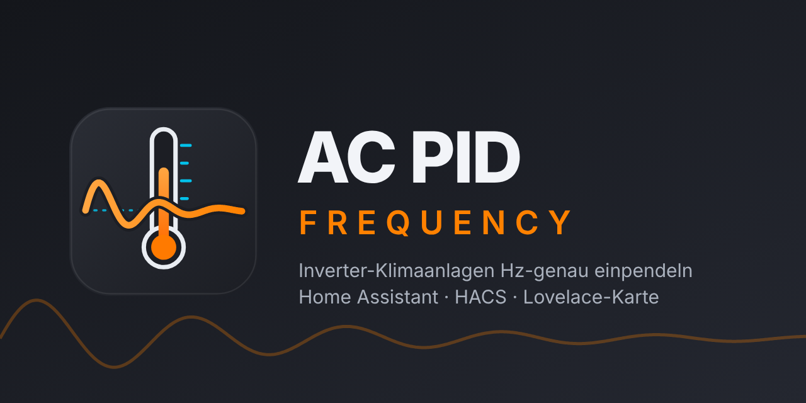

<p align="center">
  
</p>

# AC PID Frequency

Home-Assistant-Integration (HACS), die einer Klimaanlage einen **vorgetäuschten externen Raumtemperatursensor** liefert und sie damit auf eine **Ziel-Frequenz (Hz)** des Kompressors einpendelt. Die Integration beobachtet die Anlage und lernt die passende Mindestmodulation sowie den passenden Arbeitspunkt selbst.

Funktioniert mit jeder Anlage, deren Integration einen externen Raumsensor (Home-Assistant-Entität) akzeptiert **und** die Kompressor-Frequenz als Zahlen-Entität liefert. Bei Multisplit wird nur die Master-Klimaanlage gesteuert; weitere Innengeräte werden nur als Status-Anzeige mitgeführt.

## Highlights des intelligenten, selbstlernenden Algorithmus

* **Dynamisches System für Mindestmodulation & Abschaltschutz:** Mindest-Hz werden getrennt nach Außentemperaturzonen gelernt; User- und Wettertrigger können eine Re-Validierung auslösen. Soft Probing prüft nach stabiler Mindestmodulation behutsam, ob der Kompressor tiefer modulieren kann.
* **Selbstlernende Reaktionszeit & Verstärkung:** Ermittelt dynamisch aus echten Sprungantworten der Anlage die Totzeit und den Hz-Sprung je 0,1 K.
* **Momentum-Erkennung:** Bewegt sich der Kompressor bereits dynamisch auf das Ziel zu, wartet der Regler ab und verhindert überhastetes Nachlegen.
* **Abtau- & Nach-Abtau-Behandlung:** Während der Abtauung wird der Reglerstatus `defrost` ausgegeben. Nach Ende des Abtauens wartet er **240 Sekunden**, meldet dabei separat den Status `after-defrost-timer` und setzt anschließend die normale Regelung fort.
* **Wetterabhängiges Arbeitspunkt-Lernen:** Lernt den nötigen Grund-Offset getrennt nach Außentemperaturzonen und Frequenzbereichen.
* **Thermischer Überhitzungsschutz:** Drosselt die Frequenz sanft, wenn die tatsächliche Raumtemperatur zu hoch wird.
* **Echte Raumtemperatur durchreichen:** Ist der Regler aus oder die Anlage heizt nicht, kann der erzeugte Sensor die echte Raumtemperatur weitergeben.

## Installation

1. HACS → Benutzerdefinierte Repositories → dieses Repository als *Integration* hinzufügen → installieren → **Home Assistant neu starten**. (Manuell: Ordner `custom_components/ac_pid_frequency` nach `/config/custom_components/` kopieren und neu starten.)
2. Einstellungen → Geräte & Dienste → Integration hinzufügen → **AC PID Frequency**.
3. Master-Klimaanlage und Kompressor-Frequenz auswählen; Außentemperatur, Raumsensor, Abtau-Sensor und weitere Innengeräte sind optional.
4. In der Integration der Klimaanlage den erzeugten Sensor **„Simulierte Raumtemperatur“** als externen Raumsensor eintragen.
5. Lovelace-Karte hinzufügen und die Hz-Regelung einschalten (standardmäßig aus).

## Entitäten

| Entität | Zweck |
|---|---|
| `sensor` Simulierte Raumtemperatur | Wert für die Anlage; im Passthrough-Betrieb wird die echte Raumtemperatur weitergegeben. |
| `sensor` Status | Reglerstatus einschließlich `defrost` und `after-defrost-timer` sowie Diagnoseattribute. |
| `number` Ziel-Frequenz | Gewünschte Kompressor-Hz. |
| `switch` Hz-Regelung | Regler ein/aus. |
| Diagnose-Sensoren | Offset, gelernter Offset, Frequenzabweichung und erlernte Mindestmodulation. |

## Lovelace-Karte

Die Karte wird von der Integration ausgeliefert. Im Dashboard „Karte hinzufügen“ → **AC PID Frequency**, oder per YAML:

```yaml
type: custom:ac-pid-frequency-card
entity: climate.mein_master_innengeraet
# name: Wohnzimmer (optional)
# controller: sensor.…_status (optional, falls automatische Zuordnung scheitert)
```

Die Karte bietet Solltemperatur- und Betriebsartsteuerung, zeigt Kompressorfrequenz und Reglerstatus und ermöglicht die Bedienung der Ziel-Frequenz sowie des Reglerschalters. Der Nach-Abtau-Status wird als „Nach-Abtau-Stabilisierung“ angezeigt.

## Logo / Branding

Repository-Bilder und Logos liegen im Ordner `assets/`.

## Entwicklung / Tests

```bash
pip install pytest-homeassistant-custom-component home-assistant-frontend
python -m pytest
```
