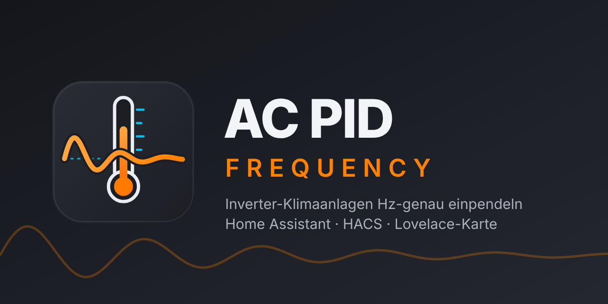

<p align="center">
  
</p>

# AC PID Frequency

Home-Assistant-Integration (HACS), die einer Klimaanlage einen **vorgetäuschten externen Raumtemperatursensor** liefert und sie damit auf eine **Ziel-Frequenz (Hz)** des Kompressors einpendelt. Die eigentliche Regelung bleibt bei der Anlage – die Integration verschiebt nur deren Eingangsgröße in 0,1-K-Schritten.

Funktioniert mit jeder Anlage, deren Integration einen externen Raumsensor (Home-Assistant-Entität) akzeptiert **und** die Kompressor-Frequenz als Zahlen-Entität liefert. Bei Multisplit wird nur das Master-Innengerät (das zuerst eingeschaltete) angegeben. Erst mal nur **Heizbetrieb**.

## Highlights des intelligenten Lernalgorithmus

* **Totzeit-Entkopplung (Patience-Timer):** Respektiert die träge Reaktionszeit der Klimaanlage (z. B. 120 s). Wenn der Kompressor bereits in Richtung Ziel beschleunigt, wird nicht vorzeitig nachgelegt.
* **Wetterabhängiges 2D-Arbeitspunkt-Lernen:** Lernt den nötigen Grund-Offset getrennt nach Außentemperaturzonen (Frost `< 2 °C`, Übergang `2–10 °C`, Mild `> 10 °C`) und Frequenzbereichen. So zerschlägt ein milder Herbsttag nicht die Erfahrungswerte für kalte Winternächte.
* **Überschwinger-Dämpfung:** Schießt die Frequenz über das Ziel hinaus, wird der gelernte Grund-Offset für diesen Bereich automatisch verringert.
* **Abtau-Erkennung (Defrost):** Erkennt Abtauzyklen (über `hvac_action` oder optionalen Sensor) und pausiert Notbremse und Lernen.
* **Thermischer Überhitzungsschutz:** Bremst die Frequenz ab, wenn die tatsächliche Raumtemperatur die Solltemperatur um mehr als z. B. 1,0 K überschreitet.
* **Echte Raumtemperatur durchreichen:** Ist der Regler aus (oder die Anlage heizt nicht), gibt der erzeugte Sensor die echte Raumtemperatur 1:1 weiter – die Anlage rechnet dann weiter mit deinem Raumthermometer statt mit ihrem oft zu warmen Deckensensor.


## Installation

1. HACS → Benutzerdefinierte Repositories → dieses Repository als *Integration* hinzufügen → installieren → **Home Assistant neu starten**.
   (Manuell: Ordner `custom_components/ac_pid_frequency` nach `/config/custom_components/` kopieren und neu starten.)
2. Einstellungen → Geräte & Dienste → Integration hinzufügen → **AC PID Frequency**.
3. Auswählen:
   * **Master-Klimaanlage** (Pflicht)
   * **Kompressor-Frequenz** (Pflicht)
   * **Außentemperatur** (optional: Sensor oder Wetter-Entität)
   * **Echter Raumtemperatursensor** (optional: Überhitzungsschutz und Durchreichen bei ausgeschalteter Regelung)
   * **Abtau-Sensor** (optional: Binary Sensor oder Sensor)
   * **Weitere Innengeräte** (optional: nur Anzeige)
4. In der Integration der Klimaanlage den erzeugten Sensor **„Simulierte Raumtemperatur“** als externen Raumsensor eintragen.
5. Karte hinzufügen (siehe unten), **Hz-Regelung** einschalten (ist nach der Einrichtung bewusst aus).

Alles lässt sich später ändern: Integration → *Konfigurieren* → „Entitäten ändern“ bzw. „Regelparameter ändern“.

## Entitäten

| Entität | Zweck |
|---|---|
| `sensor` Simulierte Raumtemperatur | Wert für die Anlage (0,1 K). Regler aus oder Anlage heizt nicht: **echte Raumtemperatur wird durchgereicht** (Offset 0,0 K, Änderungen sofort). **Wird `unavailable`**, wenn dann der Raumsensor fehlt bzw. keiner konfiguriert ist oder wenn bei laufender Regelung Daten zu lange fehlen → die Anlage nutzt ihren eigenen Innensensor |
| `number` Ziel-Frequenz | Gewünschte Kompressor-Hz. Hier schreiben eigene Automationen hinein (z. B. PV-Logik) |
| `number` Notbremse-Frequenz | Oberhalb davon wird der Sensor sofort wärmer gestellt (Standard 70 Hz) |
| `switch` Hz-Regelung | Regler ein/aus |
| `button` Gelernte Werte zurücksetzen | Setzt die 2D-Lerntabelle auf Standardwerte zurück |
| Diagnose-Sensoren | Status (inkl. `defrost` und `overheat`), Offset, gelernter Offset, Frequenzabweichung |

Beispiel für eine eigene Automation (z. B. PV-Logik):

```yaml
action: number.set_value
target:
  entity_id: number.ac_pid_frequency_ziel_frequenz
data:
  value: "{{ 48 if is_state('input_boolean.pv_ueberschuss', 'on') else 22 }}"
```

## Durchreichen der echten Raumtemperatur

| Situation | Sensor „Simulierte Raumtemperatur“ |
|---|---|
| Regler **ein**, Anlage heizt | Regelwert (Soll − Offset) |
| Regler **aus** *oder* Anlage nicht im Heizbetrieb, Raumsensor liefert Wert | echte Raumtemperatur, auf 0,1 K gerundet; folgt jeder Änderung **sofort** |
| Regler aus / kein Heizbetrieb, Raumsensor fehlt oder nicht konfiguriert | `unavailable` → Anlage nutzt ihren eigenen Sensor |
| Regler ein, aber Soll-Temperatur/Hz fehlen > Fehler-Wartezeit | `unavailable` (Status `fault`) |

Die Diagnose-Attribute des Status-Sensors zeigen mit `passthrough: true`, wann durchgereicht wird; die Karte blendet das ebenfalls ein.

## Lovelace-Karte

Wird von der Integration mitgeliefert und automatisch geladen (kein Eintrag unter *Ressourcen* nötig). Im Dashboard „Karte hinzufügen“ → **AC PID Frequency**, oder per YAML:

```yaml
type: custom:ac-pid-frequency-card
entity: climate.mein_master_innengeraet
# name: Flur            (optional)
# show_units: false     (weitere Innengeräte ausblenden)
# controller: sensor.…_status   (nur falls die automatische Zuordnung scheitert)
```

Die Karte sieht aus wie die Thermostat-Karte (Ziehbogen, +/-, Betriebsarten) und zeigt zusätzlich Kompressor-Ist-Hz mit Balken (Ziel = weiß, Notbremse = rot), Eingabefeld mit +/- für die Ziel-Hz, Regler-Schalter mit Status (inkl. Abtau- und Überhitzungsanzeige), Notbremse und weitere Innengeräte. Ein Klick auf ein weiteres Innengerät öffnet dessen Klima-Dialog (Temperatur, Lüfter usw.).


## Logo / Branding

Die Logos liegen im Ordner `custom_components/ac_pid_frequency/brand/` (`icon`, `logo`, jeweils `dark_` und `@2x`). Ab **Home Assistant 2026.3** werden sie von dort automatisch genutzt – ohne Eintrag im brands-Repository. Im Repository-Root liegen `icon.png` und `logo.png` für HACS/GitHub, unter `assets/` das Banner (`banner.png`, auch als `social-preview.png` für die GitHub-Repo-Einstellungen) und die SVG-Quellen.

## Entwicklung / Tests

```bash
pip install pytest-homeassistant-custom-component home-assistant-frontend
python -m pytest
```
